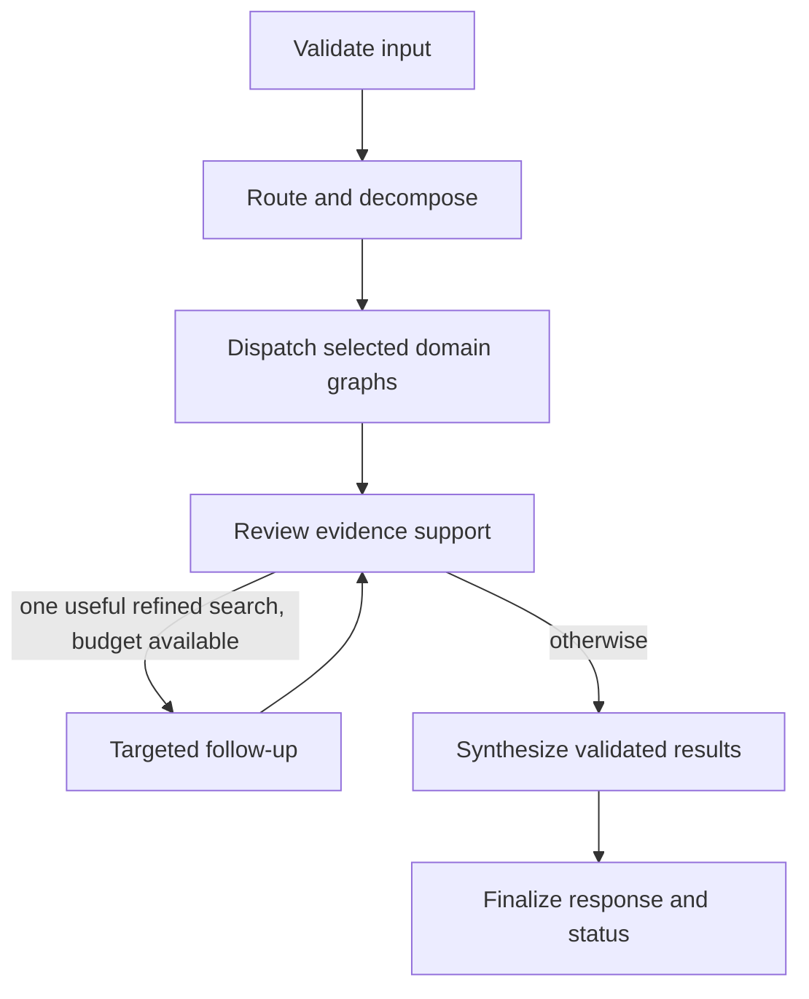
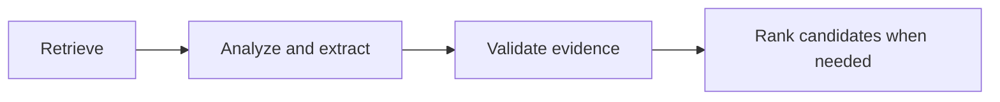

# Divpreet's agent implementation

This implements Person A's scope. The knowledge collection/index and the retail,
FastAPI, and Streamlit implementations belong to the two teammates. No endpoint
server is needed to run or test these agents. Shared public contracts cover all
three teammates; the actual retail model and API handlers are not implemented here.

## Start locally

From the repository root, using Python 3.11:

```bash
python3 -m venv .venv
.venv/bin/python -m pip install -r requirements.lock.txt
.venv/bin/python -m pip install -e . --no-deps
.venv/bin/pytest -q
.venv/bin/consult ask --mode demo \
  --question 'Which laboratory instrument supports at least 12 samples per run?'
```

Alternatively install editable with `pip install -e '.[dev]'` to resolve the
declared version ranges. `requirements.lock.txt` pins the environment used for
verification. Optional `app`, `knowledge`, and `retail` extras declare the
teammates' anticipated packages but are not required for agent tests.

Demo mode needs no key, network, or downloaded embedding model. It uses the
explicitly synthetic chunks in `fixtures/consulting/evidence.json` and a fake
router/specialist/reviewer. It verifies integration behavior, not model quality.
Every result carries `mode: demo` and a warning. It never silently activates in live
mode. Demo search matches metadata against a tiny fixed corpus; it is not RAG
retrieval accuracy or a replacement for the real KB.

## Live Cohere setup

Copy `.env.example` to `.env` and set `COHERE_API_KEY` locally. Leave
`LLM_PROVIDER=cohere` and start with `COHERE_MODEL=command-a-03-2025` for all
roles. The key stays on the server, never in frontend request bodies. Optional
`COHERE_ROUTER_MODEL`, `COHERE_SPECIALIST_MODEL`, and `COHERE_SYNTHESIS_MODEL`
overrides inherit the base model when empty. Review uses the specialist override.
There is no silent model/provider downgrade. A service instance shares one paced
provider adapter across its graphs; multiple worker processes/machines need their
own coordinated rate policy for the same API key.

Before the full KB is available, you can already test real-model routing,
extraction/ranking, and citation behavior using selected real passages:

```bash
.venv/bin/consult ask --mode live \
  --evidence-file fixtures/consulting/controlled_real_passages.json \
  --question 'What operational risks does Cisco disclose in its 2025 filing?' \
  --context-json '{"company":"Cisco","report_years":[2025]}'
```

See [CONTROLLED_TESTS.md](CONTROLLED_TESTS.md) for real-source provenance,
candidate-ranking checks, and the distinction from full retrieval evaluation.
The response warns that this is controlled evidence; it is not the fake demo.

Once the KB teammate supplies a factory, test full retrieval integration:

```bash
.venv/bin/consult ask --mode live \
  --knowledge-factory consulting_platform.knowledge.service:create_knowledge_service \
  --question 'What operational risks does Cisco disclose in its 2025 filing?' \
  --context-json '{"company":"Cisco","report_years":[2025]}'
```

The factory path above loads the implemented local knowledge service.
It must return the shared `KnowledgeService` interface. Live use needs both real
KB artifacts and a working provider credential. Missing either is reported;
fixtures never enter a live corpus. The API teammate will call the same service
directly as shown in [INTEGRATION.md](INTEGRATION.md).

To verify provider access before the real KB exists, run
`.venv/bin/python scripts/check_model.py`. It makes one small external API request
(plus at most one format repair for that call, within the shared three-repair/request cap) and prints a sanitized
pass/fail outcome. It is not run by unit tests or health checks.

An explicit Mistral alternative is supported: set `LLM_PROVIDER=mistral`,
`MISTRAL_API_KEY`, and `MISTRAL_MODEL=mistral-small-latest`. Corresponding
`MISTRAL_*_MODEL` role overrides also work. Switching provider does not change
the public request/response or retrieval contracts. Account-specific model
availability must be checked using the actual key.

## Manager state machine



| Node | What it does |
|---|---|
| `validate_input` | Detects obvious question/context company or year conflicts. |
| `route` | A model selects zero or more domains, makes subquestions, and extracts explicit customer constraints. Validates numeric constraints and asks for missing router diagnostics. |
| `dispatch_specialists` | Runs the selected specialist graphs concurrently, with isolated states. Deterministic context conflicts stop retrieval. |
| `validate_evidence` | Builds the citation registry from actual chunks; a separate model pass checks whether claims and comparisons are supported. Unaccepted claims are removed. |
| `targeted_follow_up` | Runs at most one selected specialist again using its refined query, without exceeding two retrieval rounds for that domain. |
| `synthesize` | Selects/orders existing validated findings/actions, proposes ordering links between existing recommendations, and flags conflicting evidence. It cannot inject new factual prose. |
| `finalize` | Trims recommendations, resolves citations, computes status/uncertainty, and validates the public response. Operational traces disclose calls, not hidden reasoning. |

The manager's state holds the immutable request/context, request ID, per-request
call budget, domain tasks, isolated specialist results, validated findings,
recommendations, citation registry, warnings, and short trace events. There is no
cross-request memory or persistence. Each follow-up customer question is a new
request carrying updated context.

The summary is assembled from validated findings and recommendation titles.
Cross-domain action order is a proposed plan, not a claim of technical causality
or guaranteed ROI. Conflicting evidence suppresses recommendations pending
clarification. Model-based support review improves checks but does not prove
entailment; human/source-based evaluation is still needed.

## Four specialist state machines

Each domain has its own compiled graph and policy; they share the same topology:



| Node | What it does |
|---|---|
| `retrieve` | Calls B's KB with allowed domain/company/year filters. Re-checks returned metadata, mode, duplicate IDs, and `top_k`. |
| `analyze_extract` | The model produces cited findings, product facts, proposed actions, missing information, and optionally one refined query. It is skipped on empty/unavailable evidence. |
| `validate_evidence` | Checks that IDs exist, quotes are verbatim, candidate names are present, and numeric values/units occur in their quoted sources. Unknown attributes stay unknown. |
| `rank_candidates` | Pure Python filters violated hard requirements, flags unknown requirements, and scores supported matches. Findings-only questions skip ranking. |

The manager can re-enter one specialist for a second retrieval round. Specialists
cannot launch arbitrary agents, make purchases, execute code, or browse the web.
Their tools are explicitly controlled Python calls; native provider function
calling is not required for the bounded workflow.

| Specialist | Policy |
|---|---|
| Technology | Specifications/compatibility and evidence-backed troubleshooting. Symptoms are not a confirmed failed component. Missing model/diagnostics prompts clarification. |
| Clinical | Laboratory instrument selection and capabilities. Product pages do not establish repair procedures or patient-treatment recommendations. |
| SEC | Company/fiscal-year-specific disclosures; no substitution of a newer year for an explicit requested year. |
| Corporate responsibility | Food-security/CSR evidence with report-year filters. Interventions and success metrics are proposals, not demonstrated vendor impact. |

## Ranking and grounding

`agents/models.py` has private `Constraint`, `Candidate`, `AttributeFact`, and
`Support` models. Each candidate identity and attribute has evidence references
and exact quotes; these are separate from public API schemas.

`agents/ranking.py` compares explicit attributes to constraints. A violated hard
constraint excludes a candidate; an unknown hard constraint makes it conditional.
Conditional/excluded candidates stay in the internal comparison but are not
published as product recommendations. Publication also requires at least one
validated matched constraint. No criteria means no product recommendation.
Missing constraints never establish suitability. Weights default to one; scores
are weighted satisfied fractions, not learned probabilities. Only explicitly
compatible unit families are converted. Unsupported/ambiguous extraction is
removed or qualified rather than guessed. The manager rejects a numeric constraint
whose value was not present in customer input, and conditions comparisons with
unrepresented requirement counts. Interpretation remains a model limitation.

This is independent of both B's passage ranking and C's basket recommendations.
The candidate ranker is not an exhaustive product catalog or an unrestricted
procurement system. Start with a few supported equipment comparisons and grow
coverage using real source tests.

PDF quote validation tolerates line-wrap whitespace and straight/curly quotation
glyph differences only. It recovers and stores the original source substring,
including its original punctuation. Changed words, quantities, dashes, invented
IDs, and spliced/elliptical quotes remain invalid. Rejection warnings identify
the category without logging raw model output.

For a pipe-delimited table only, an exact header plus a nonadjacent exact model
row can be recovered as two separate verbatim supports. This does not create a
combined quotation. Wrong rows and changed wording remain invalid. Speed-qualified
port-count units normalize to `ports` only when the same speed is explicit in the
attribute key; rates and counts are never interchanged.
A cited model row can also acquire its actual table header through deterministic
extraction: the speed-specific port column must be unique and its numeric cell
must equal the extracted value. This derives the count unit from the source and
rejects values borrowed from another speed column or a `-` cell.

## Cross-domain result reliability

`agents/port_tables.py` independently extracts speed-specific port counts from
retrieved, labeled pipe tables. It binds facts to the task's keys and units rather
than depending on the model to reproduce them. Complete explicit context criteria
such as `At least 5 1G Ethernet ports per site` have a bounded parser; complex
clauses are left to normal analysis. Missing/dash, fractional, duplicate-column,
or conflicting cells remain unknown. No model names or winners are hardcoded.

When all criteria were explicitly parsed and verified against source cells,
eligibility is a deterministic result. Model review/selection cannot erase that
narrow comparison merely by omitting its ID. This does not authorize overall
deployment suitability or bypass semantic review of other claims. Without this
proof, model review still governs publication.

`agents/csr_actions.py` keeps connectivity proposals at the feasibility stage.
General SOFI data-quality priorities do not justify procurement or rollout:
premature commitments are excluded, while retained assessments explicitly describe
benefits as hypotheses. Valid premises can be exposed as literal source excerpts.
If only a proposal survives review, the summary describes its cited source basis
and unverified outcome rather than calling the domain wholly unanswered.

Specialists receive domain-scoped assignments and context. They report missing
sources through the private `missing_evidence` field; clarification questions are
reserved for customer facts/preferences. Semantic review also checks whether
proposed questions are actually needed given the existing request. Duplicate
questions and legacy source-upload requests are filtered. Submissions remain
independent; no conversation history is added.

Customer-facing source-availability warnings come from retrieved metadata and
requested filters. Model limitations/review notes and extraction rejection details
are preserved as domain-tagged trace diagnostics, shown under **Evidence checks
and specialist notes**, rather than asserted as global source-availability facts.
This does not prove complete coverage of a retrieved document or validate every
free-text statement. The UI keeps material coverage/validation notices visible.

The final summary starts with comparison decisions, then includes validated
findings or an explicit unresolved result for every requested domain. Product
alternatives cannot have execution-order dependencies; only business/diagnostic
actions can be sequenced. The public request/response schemas and retail flow are
unchanged. Regression coverage lives in `tests/agents/test_reliability.py`.

Cohere requests use a provider-compatible JSON Schema. Dynamic dictionaries are
encoded internally as key/value records and decoded back into the same canonical
Python models; public API/KB contracts do not change. The adapter can discard
surrounding prose/fences and one exact model-name wrapper before full validation.
It never repairs incomplete JSON or invents fields/values. Model prose is not
returned or logged. A bounded repair request receives field paths/error types;
final errors identify the failing role without exposing provider bodies. A
`MAX_TOKENS` stop discards the incomplete output and can use the same single
repair allowance for a fresh, compact response with twice the output budget
(capped at 8,000 tokens). Error messages include the stop reason and token limit.

## Bounds and failure handling

- At most 12 model calls per request, including at most one global JSON/truncation
  repair attempt shared across all roles. No hidden transport retries. A process-local limiter defaults to
  18 requests/minute. Provider throttling is an availability error, not fake output.
- At most two retrieval rounds per specialist and one manager follow-up per
  request. Selected domains are isolated before merge.
- Controlled evidence disables query-refinement follow-ups: it returns the same
  selected passages regardless of query. Other services default to supporting
  refinement. Optional follow-ups also require enough wall-clock headroom for
  review and synthesis, in addition to the model-call budget.
- An overall configurable deadline cannot exceed 90 seconds. Individual provider
  calls default to 30 seconds. External cancellation propagates.
- `answered`, `partial`, `needs_clarification`, and `insufficient_evidence` are
  normal domain results. Healthy zero-match retrieval is not an infrastructure error.
- Complete dependency failure raises shared exceptions for the API to map to
  503/504/502. Unknown programming errors are not converted into plausible advice.
- Citation IDs/paths/excerpts come from retrieved objects, never model-written
  URLs. A live/demo mode mismatch is rejected. Evidence is untrusted data.

## Tests, schemas, graphs, evaluation

```bash
.venv/bin/pytest -q
.venv/bin/ruff check src scripts tests
.venv/bin/python scripts/export_contracts.py
.venv/bin/consult graphs
.venv/bin/python scripts/evaluate_consulting.py --mode demo --split development
```

Exported public schemas live in `schemas/v1/`; the original contract examples and
synthetic evidence live in `fixtures/consulting/`. Machine-generated Mermaid files
are in `docs/graphs/`, one manager plus four specialists. No diagram generation
requires sending source data to a third-party rendering service.

The evaluator and its review rubric are described in
`evaluation/consulting/README.md`. The 24-case file is a proposed real-source
evaluation set with explicit development/test labels; gold chunk IDs and human
reviews still need the actual frozen KB and team labeling. Unmeasured metrics
stay null. A synthetic smoke report is not a live quality benchmark.

## Provider decision checked October 17, 2026

Start with a single Cohere Command A+ model across roles, then compare alternatives
on development cases if quality/latency justifies it. Multiple agents do not require
multiple models. The default is a practical choice, not a measured claim that it
is best on this dataset. Command A (`command-a-03-2025`) is another configurable
option; optional R7B routing should be evaluated before enabling it.

Cohere lists Command A+ and the other relevant Command models as live and supplies
structured JSON generation. Its evaluation keys are free but limited: the current
published limits include 1,000 API calls/month and 20 chat requests/minute/model.
A consultation uses several calls, so do not equate 1,000 calls with 1,000 chats.
Mistral also documents a free mode with usage/rate limits; actual model entitlement
and quotas depend on the workspace. Neither should be assumed unlimited.

Sources:
- https://docs.cohere.com/docs/models
- https://docs.cohere.com/docs/rate-limits
- https://docs.cohere.com/v2/docs/structured-outputs
- https://docs.cohere.com/v2/reference/chat
- https://docs.mistral.ai/getting-started/quickstarts/studio/activate-and-generate-api-key

No live provider response or real-corpus quality is claimed by the implementation
tests. The user still needs to configure a key and integrate the teammate's KB.


See [Answer completeness and demo verification](ANSWER_VALIDATION.md) for the private
per-question coverage checklist, focused retrieval, cited narrative, and repeated
live acceptance commands. Public HTTP contracts are unchanged.
