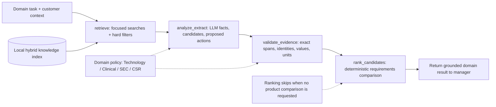
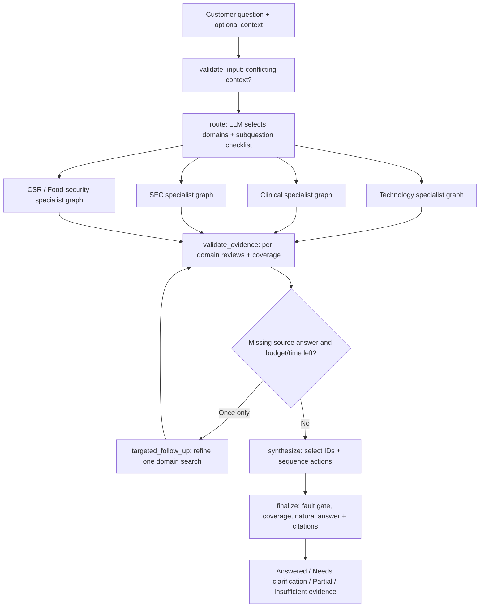
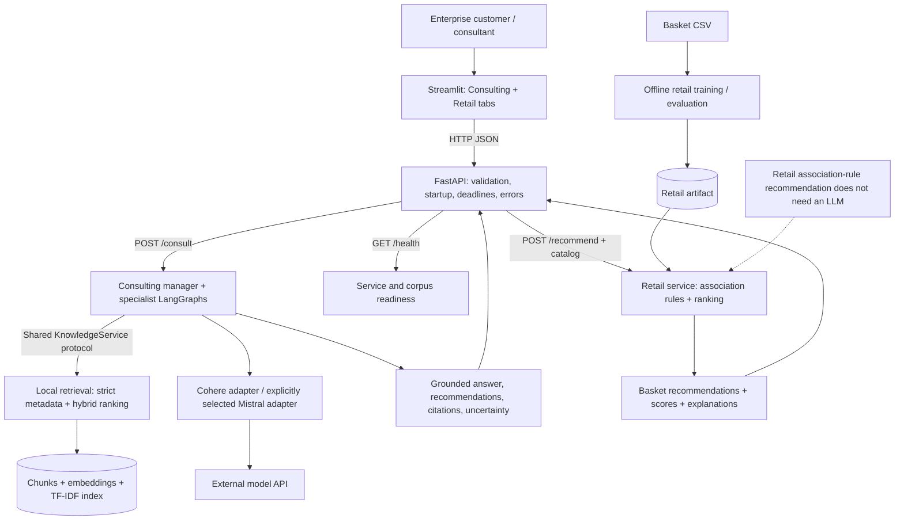
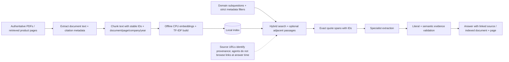
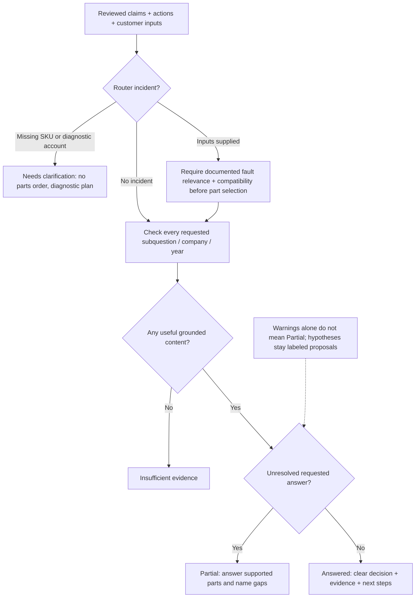

# Project architecture

Open [the offline visual walkthrough](architecture.html) for four rendered SVG diagrams,
or open the individual [specialist](graphs/specialist_workflow.svg),
[multi-agent](graphs/multi_agent.svg), [overall project](graphs/project_architecture.svg)
and [RAG pipeline](graphs/knowledge_pipeline.svg) diagrams. Regenerate the visual
exports locally with `.venv/bin/python scripts/render_architecture.py`.

These diagrams describe the implemented prototype. Open this Markdown in a Mermaid-capable preview or on GitHub. Each diagram also has an editable `.mmd` file. The five existing `manager.mmd`, `technology.mmd`, `clinical.mmd`, `sec.mmd`, and `corporate_responsibility.mmd` files are generated from the actual compiled LangGraphs with `.venv/bin/consult graphs`.

## Specialist Workflow

All four specialists compile this same four-node topology with separate state and policies. Only analyze_extract calls the model; retrieval, literal checks and ranking are application code. SEC may extract separate companies concurrently within that node; Clinical may extract two independent subjects in separate bounded batches. These are bounded workflows, not arbitrary tool-selection loops.

## Multi Agent

Only selected specialists execute. Their graphs run concurrently, then the manager reviews each domain and checks each requested subquestion. At most one targeted follow-up search is allowed if the call and time budgets permit. The manager has one routing node; it does not need one reasoning node per specialist. Synthesis selects existing supported IDs; the final composer writes the customer response.

## Project Architecture

Consulting and retail share the UI and HTTP server but use separate services. Retail uses learned basket association rules, not an LLM-only recommender. The configured hosted model handles consulting routing/extraction/review/selection; it does not receive API secrets as prompt text. Readiness measures availability, not proven answer quality.

## Knowledge Pipeline

Ingestion downloads/reads source documents before indexing. Runtime agents retrieve stored text and exact spans; having a URL in metadata does not give an agent a web-browsing tool. Rebuild the index after source/chunk changes, not after prompt or UI changes. CPU embedding execution is serialized inside retrieval to avoid the earlier native concurrency crash.

## Answer Decisions

Missing customer facts and missing source coverage are different. Supplying a model family does not supply diagnostics. A user-reported diagnostic account is still a reported premise, not independently verified fault evidence. A source may support a product feature without answering why a customer outage occurred. Fault-specific parts advice must pass compatibility and semantic checks; none can be inferred from co-occurrence.

## Code map

- `agents/service.py`: manager graph and fault/coverage gates.
- `agents/specialists.py`: individual specialist graphs.
- `agents/diagnostics.py`: diagnostic intake and proposed investigation.
- `agents/answer.py`: customer answer from accepted claims/actions.
- `knowledge/service.py` and `retrieval.py`: runtime retrieval and citation context.
- `knowledge/index.py`: offline index build.
- `api/app.py`: API factory and service wiring.
- `ui/app.py`: two-tab interface and examples.
- `retail/`: training, rule ranking, artifact-backed recommendations.
